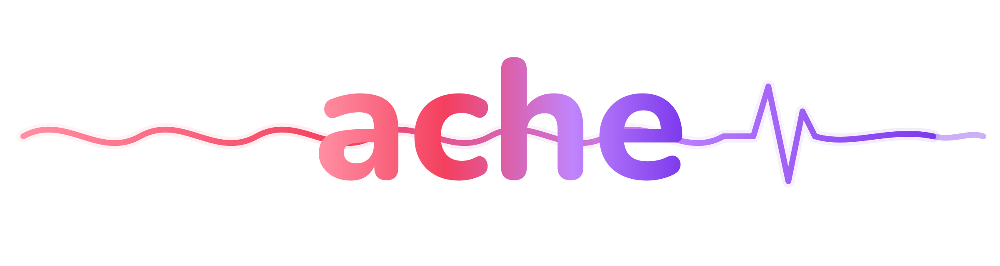

  

# ache — unified haptics, by Nice Thoughts Ranch

Home of **ache**, Nice Thoughts Ranch's unified haptics MCP
server, and of the Lovense integration work around it: the
studio's presence in the Lovense App Gallery, toy integration
for STROBE, and media-sync research for future interactive media.

This is a planning and integration repo. It contains no credentials.
Its production code is the MCP server in [`mcp/`](mcp/README.md) —
**ache**, the unified haptics server (Lovense Standard API local
route + embedded Buttplug + the opt-in Server API cloud route,
behind one gated tool surface), built under the checklist
gates below.

## Start here

- [mcp/README.md](mcp/README.md): ache, the unified haptics MCP
  server — its safety contract, tool surface, and configuration.
- [CHECKLIST.md](CHECKLIST.md): the phased work list, account and
  console setup first, code last.
- [TESTING.md](TESTING.md): the test ladder for the integration,
  mock first, live hardware last and gated.
- [DOCS-NOTES.md](DOCS-NOTES.md): condensed notes from the official
  Lovense developer documentation (read 2026-10-20), including the
  per-plugin capability matrix and the sub-pages still to read.
- [TOYS.md](TOYS.md): the current Lovense developer-program toy
  catalog (24 devices with product pages).
- [EXAMPLES.md](EXAMPLES.md): three Lovense games read as design
  references (Projekt Melody, Iced Coffee with Breastmilk,
  CumPartment), with what STROBE takes from each.

## Roadmap

- **Now — v1.0.0 (live on crates.io).** The unified gated server:
  Lovense Standard API (local Game Mode route) + embedded Buttplug
  behind one tool surface, every output through the pure `decide()`
  gate. 10 tools.
- **In release prep — v1.1.0.** *Symphony*, the multi-toy score
  layer: per-device parts planned through the same gate, concurrent
  dispatch, one ensemble latching stop. Plus the MCP Registry
  listing under `io.github.NTRanch/ache`.
- **In development.** An optional Server API provider for true
  internet remote play — off by default, behind the same gate,
  developer token held in the user's password store, QR pairing as
  an explicit user act. Local custody stays the default.
- **In production.** A live interactive demo: an animated performer
  whose reactions are driven in real time through ache, with
  genuine live device switching between toys on screen.
- **Design stage.** Muse Gadgets: a physical stop button and an
  e-ink status surface for the gate's state (armed, ceiling,
  watchdog) — hardware witnesses to the contract, not decorations.
- **Hardware ladder.** Live-device verification rungs, mock first,
  hardware last and gated, per [TESTING.md](TESTING.md).

## Toy coverage

ache covers the full Lovense catalog below. One honesty rule governs
the whole table: Lovense publishes no static per-toy function list —
a connected toy *reports* its functions at runtime (`GetToys`), and
ache reads the reported capabilities and drives only what is
reported. The functions below are the expected reported set per toy.
Features with no API action (heating, tapping, touch-sense) are
named as app-only or input-only — the gate refuses them by name
rather than pretending to map them.

Routes: **GM** = Lovense Game Mode / Standard API via the Remote
app (local LAN); **BLE** = direct Bluetooth via the embedded
Buttplug provider.

| Toy | How ache controls it | Route |
| --- | --- | --- |
| [Ambi](https://www.lovense.com/p/Dev_Ambi) | Vibrate | GM + BLE |
| [Calor](https://www.lovense.com/p/Dev_Calor) | Vibrate — heating is app-only (no API action; refused by name) | GM + BLE |
| [Diamo](https://www.lovense.com/p/Dev_Diamo) | Vibrate (multi-motor) | GM + BLE |
| [Dolce](https://www.lovense.com/p/Dev_Dolce) | Vibrate ×2 motors | GM + BLE |
| [Domi 2](https://www.lovense.com/p/Dev_Domi2) | Vibrate | GM + BLE |
| [Edge 2](https://www.lovense.com/p/Dev_Edge2) | Vibrate ×2 motors | GM + BLE |
| [Exomoon](https://www.lovense.com/p/Dev_Exomoon) | Vibrate (generic BLE match) | GM + BLE |
| [Ferri](https://www.lovense.com/p/Dev_Ferri) | Vibrate | GM + BLE |
| [Flexer](https://www.lovense.com/p/Dev_Flexer) | Vibrate ×2 + Fingering (modelled as a rotate feature on BLE) | GM + BLE |
| [Gemini](https://www.lovense.com/p/Dev_Gemini) | Vibrate ×2 motors | GM + BLE |
| [Gravity](https://www.lovense.com/p/Dev_Gravity) | Vibrate + Thrusting (modelled as oscillate on BLE) | GM + BLE |
| [Gush](https://www.lovense.com/p/Dev_Gush) | Vibrate | GM + BLE |
| [Hush 2](https://www.lovense.com/p/Dev_Hush2) | Vibrate | GM + BLE |
| [Hyphy](https://www.lovense.com/p/Dev_Hyphy) | Vibrate ×2 motors | GM + BLE |
| [Kraken](https://www.lovense.com/p/Dev_Kraken) | Vibrate (generic BLE match) | GM + BLE |
| [Lapis](https://www.lovense.com/p/Dev_Lapis) | Vibrate ×3 motors (tip / internal / external) | GM + BLE |
| [Lush 3](https://www.lovense.com/p/Dev_Lush3) | Vibrate | GM + BLE |
| [Max 2](https://www.lovense.com/p/Dev_Max2) | Vibrate + Pump + Suction (pump modelled as constrict on BLE) | GM + BLE |
| [Nora](https://www.lovense.com/p/Dev_Nora) | Vibrate + Rotate | GM + BLE |
| [Osci 2](https://www.lovense.com/p/Dev_Osci2) | Vibrate + Oscillate on GM; BLE models vibration only | GM + BLE |
| [Ridge](https://www.lovense.com/p/Dev_Ridge) | Vibrate + Rotate | GM + BLE |
| [Sex Machine](https://www.lovense.com/p/Dev_SexMachine) | Oscillate | GM + BLE |
| [Solace](https://www.lovense.com/p/Dev_Solace) | Thrusting + Fingering on GM; oscillate only on BLE | GM + BLE |
| [Vulse](https://www.lovense.com/p/Dev_Vulse) | Vibrate + Thrusting on GM; BLE models vibration only | GM + BLE |
| [Lush 4](https://lovense.store/) | Vibrate — LED tail lighting is app-only | GM + BLE |
| [Lush 2](https://lovense.store/) | Vibrate | GM + BLE |
| [Lush Mini](https://lovense.store/) | Vibrate (generic BLE match) | GM + BLE |
| [Glint](https://lovense.store/) | Vibrate (generic BLE match) — touch-sense is input-only, never an output | GM + BLE |
| [Spinel](https://lovense.store/) | Vibrate + Thrusting (modelled as oscillate on BLE) — heating is app-only | GM + BLE |
| [Fizz](https://lovense.store/) | Suction — tapping has no API action; refused by name | GM + BLE |
| [Mission 2](https://lovense.store/) | Vibrate — touch-sense is input-only, never an output | GM + BLE |
| [Velvo](https://lovense.store/) | Vibrate + Rotate (the rolling bead is modelled as rotation) | GM + BLE |
| [Tenera 2](https://lovense.store/) | Suction on GM; the generic BLE match does not model suction | GM + BLE |
| [Osci 3](https://lovense.store/) | Vibrate + Oscillate — warming is app-only | GM + BLE |
| [Mini Sex Machine](https://lovense.store/) | Oscillate | GM + BLE |
| [Ferri Reserve](https://lovense.store/) | Vibrate | GM + BLE |

Storefront models (below the developer-program 24 in the table)
link to the Lovense store; per-toy control detail is in the
coverage research behind [TOYS.md](TOYS.md). Solace Pro is covered
by the same gate vocabulary (Position / Stroke / Depth) and is
driven wherever it reports those functions.

## The Lovense surfaces, and which ones are ours

Lovense publishes several unrelated API families. Keeping them
straight is most of the work:

1. **Standard API (Game Mode, local LAN).** The game talks directly
   to the Lovense Remote app on the player's network. This is
   STROBE's integration route; a gated bridge implementation already
   exists in the STROBE project (master toggle defaults off, output
   clamped in the bridge, stop is first-class). The server route of
   the Standard API (commands relayed through Lovense's cloud with a
   developer token) was evaluated and rejected for STROBE on latency
   and token-custody grounds. For ache itself the posture was later
   amended (D-1451): ache's Server API provider implements the server
   route behind the same gate, opt-in and off by default, with the
   token referenced by password-store path only — see
   [`mcp/README.md`](mcp/README.md).
2. **App Gallery platform API.** For apps hosted inside Lovense
   Remote's App Gallery. This is the surface behind the App Gallery
   Console (public profile, app listings). New territory for the
   studio; Phase 0 and Phase 4 of the checklist cover it.
3. **Pattern Editor / Media Sync SDK.** A web JavaScript SDK
   (`pattern-sdk.js`) that syncs toys to web audio/video, with
   FunScript and Lovense pattern support and an AI sync fallback.
   Relevant only if the studio ships web media; tracked as research
   in Phase 5.
4. **Game engine plugins.** Six Unity plugins (Universal Remote,
   Android, iOS, Windows Bluetooth, USB Dongle, Mac), an Unreal
   Remote plugin, a Windows BLE DLL for C/C++/C#, and a Ren'Py
   plugin. The Unity Windows and Dongle plugins are the evaluation
   candidates for STROBE's Windows build; see DOCS-NOTES.md for the
   capability matrix.
5. **Native SDKs.** iOS, Android, and Windows SDKs for standalone
   apps. Not currently planned; noted for completeness.

## Credentials

Developer credentials (token, key, IV) live in the studio password
store under `lovense/ntr/` and are referenced by path only. They are
never committed to this repo, never pasted into issues or chat, and
are used only by the server-side flows that require them.

## Official documentation

- Media Sync / Pattern Editor:
  https://developer.lovense.com/docs/media-sync.html
- Game engine plugins:
  https://developer.lovense.com/docs/game-engine-plugins/
- Native SDKs:
  https://developer.lovense.com/docs/native-sdks.html
- App Gallery Console:
  https://appgallery.lovense.com/remote/console/#/
- Developer dashboard:
  https://www.lovense.com/user/developer/info

## License

Apache-2.0. See [LICENSE](LICENSE).
